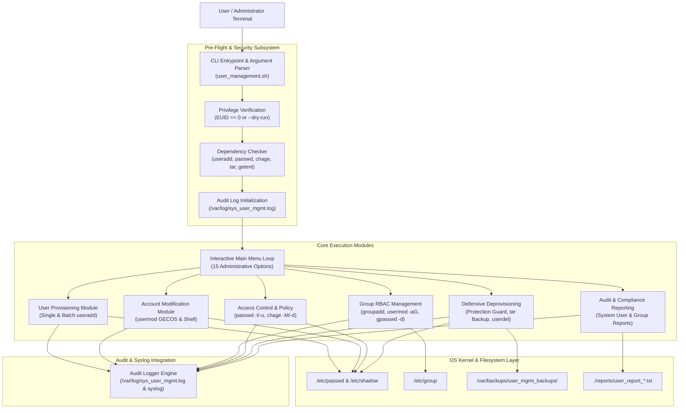
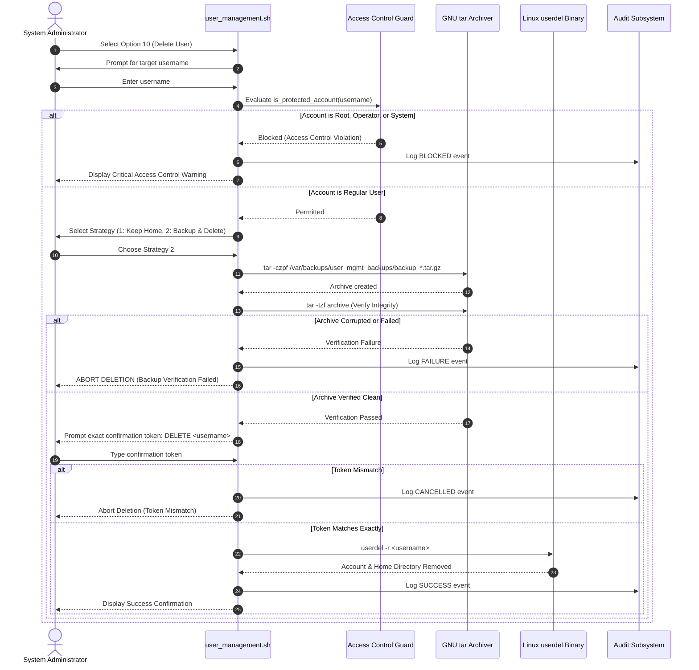

# System Architecture: Automated Linux User Management Shell Script

**Institution:** Guru Nanak Dev Engineering College, Ludhiana  
**Department:** Department of Information Technology  
**Project:** Automated Linux User Management Shell Script  

---

## 1. High-Level Architectural Diagram

---

## 2. Component & Module Breakdown

### 2.1 Pre-Flight & Security Subsystem
- **`check_privileges()`**: Inspects the Effective User ID (`$EUID`). If non-zero and not running with `--dry-run`, halts execution with a structured red terminal banner instructing the operator to invoke `sudo ./user_management.sh` or `./user_management.sh --dry-run`.
- **`check_dependencies()`**: Evaluates the local binary path for required system tools (`useradd`, `usermod`, `userdel`, `groupadd`, `gpasswd`, `passwd`, `chage`, `getent`, `tar`, `awk`, `grep`). If missing on live Linux, halts immediately; in demonstration mode, issues a non-blocking notification.
- **`init_environment()`**: Dynamically routes log paths to `/var/log/sys_user_mgmt.log` when root and writable, or falls back to `./logs/sys_user_mgmt.log` for unprivileged testing, enforcing strict file permissions (`chmod 0600`).

### 2.2 Input Validation Layer
- **`validate_username()`**: Employs POSIX regex `^[a-z_][a-z0-9_-]*$` ensuring accounts begin with a letter or underscore, consist only of lowercase alphanumeric characters, hyphens, or underscores, and do not exceed 32 characters.
- **`validate_groupname()`**: Validates group syntax matching POSIX naming standards.
- **`validate_integer()`**: Enforces positive integer constraints with boundary checks for password lifetime and warning intervals.
- **`is_protected_account()`**: Safeguards UID 0 (`root`), dynamic system accounts (UID < `UID_MIN` extracted from `/etc/login.defs`), and the active administrator (`$OPERATOR`).

### 2.3 User Lifecycle Management Module
- **Single Account Provisioning (`create_single_user`)**: Validates username, checks duplicates via `getent passwd`, validates shell against `/etc/shells`, executes `useradd -m -s "$shell" -c "$name" "$user"`, and provides an interactive PAM password configuration prompt with optional forced password change (`chage -d 0`).
- **Interactive Batch Provisioning (`create_multiple_users`)**: Queues multiple accounts, independently validates each entry, checks queue-level and system-level collisions, creates accounts in sequence, and outputs a formatted summary table of successes and failures.
- **Account Modification (`modify_user`)**: Displays current profile (UID, GID, GECOS, Shell, Groups), prompts for targeted property updates (`usermod -c` or `usermod -s`), previews changes, and confirms execution.

### 2.4 Role-Based Group Administration Module
- **Group Creation (`create_group`)**: Validates group syntax, verifies uniqueness via `getent group`, and executes `groupadd`.
- **Supplementary Group Assignment (`add_user_to_group`)**: Validates user and group existence, checks existing memberships using `id -Gn`, and appends the user using `usermod -aG` to preserve existing group relationships.
- **Group Membership Revocation (`remove_user_from_group`)**: Prevents removal from primary group (`id -gn`), removes user via `gpasswd -d "$user" "$group"`, and displays remaining group memberships.

### 2.5 Security & Authentication Hardening Module
- **Account Locking (`lock_user`)**: Explains the security distinction between password-hash locking (`passwd -l` prepending `!` in `/etc/shadow`) and full session/SSH key termination. Executes locking and verifies status via `passwd -S`.
- **Account Unlocking (`unlock_user`)**: Restores account access via `passwd -u` and logs the action.
- **Password Aging Policies (`configure_password_expiry`)**: Interfaces with `chage` to enforce maximum password lifespan (`-M`), immediate rotation at next login (`-d 0`), minimum modification intervals (`-m`), and warning lead times (`-W`).

### 2.6 Defensive Deprovisioning & Backup Engine
- **`delete_user_safely()`**: Implements a five-stage safety pipeline:
  1. **Account Protection Filter:** Refuses deletion if target is `root`, system daemon, or current operator.
  2. **Active Process Inspection:** Checks for running tasks using `pgrep -u`.
  3. **Strategy Selection:** Allows user deletion with home directory preservation, or backup-and-delete.
  4. **Verified Archival:** If backup requested, archives `/home/<username>` into `/var/backups/user_mgmt_backups/backup_<username>_<timestamp>.tar.gz` with restricted permissions (`0600`), and verifies integrity via `tar -tzf`. **If backup fails, deletion is strictly aborted.**
  5. **Mandatory Confirmation Token:** Requires typing the exact string `DELETE <username>`. Any deviation aborts the operation safely.

### 2.7 Audit & Reporting Engine
- **`log_audit()`**: Formats events into standardized records:
  `[TIMESTAMP] [OPERATOR: ...] [ACTION: ...] [TARGET: ...] [STATUS: ...] [DETAILS: ...]`
  Forwarded simultaneously to the application log (`/var/log/sys_user_mgmt.log`) and Linux system syslog daemon (`logger -t sys_user_mgmt`).
- **`generate_user_report()` & `generate_group_report()`**: Queries system account databases (`getent passwd`, `getent group`, `/etc/login.defs`), categorizes accounts into human users and system daemons, calculates summary metrics, and generates formatted ASCII reports on-screen and to disk (`./reports/`).
